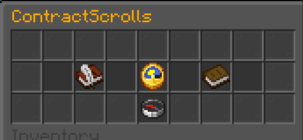
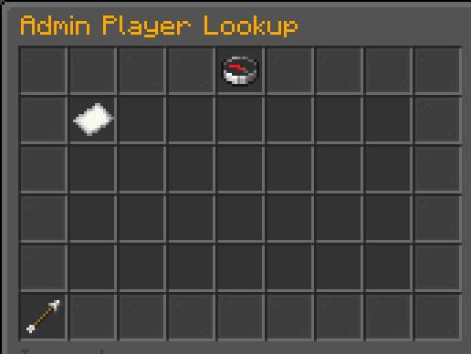

# ContractScrolls

Vanilla-feeling, lightweight [Paper](https://papermc.io/) plugin that lets players write, propose, and sign contracts. The plugin **does not enforce** the contract; it creates tamper-evident records and a server-side audit trail.
Its goal is to reduce player conflicts and give staff clearer evidence, so staff spend less time handling stealing/theft disputes.

**Version:** 1.0.0

> **MIT License**
> This project is released under the MIT License.
> You may use, modify, and redistribute it under those terms.

## Requirements
- [Paper](https://papermc.io/) 1.21.x
- [Java 21](https://adoptium.net/temurin/releases/?version=21)

## What It Does
- `/contract propose <player>` uses the writable or written book in hand as the contract terms and notifies the target.
- Optional Vault-backed proposal pricing can be charged to reduce contract spam.
- Proposing automatically records the proposer signature.
- `/contract sign <contractId>` records signatures.
- `/contract view` and `/contract list` open a contracts UI with filters.
- Clicking a contract in UI opens the contract book for reading.
- `/contract templates` shows premade clickable templates that load into a book and quill.
- Included templates now cover common SMP deals such as base builds, bulk item trades, shop restocks, resource hauls, farm access, land rental, redstone jobs, villager halls, alliances, and nether tunnel projects.
- Staff get a dedicated admin menu in the main UI for search and settings.
- Staff can open any player's contracts UI with `/contract admin search <player>`.
- Staff can also search contracts shared between two players with `/contract admin search <playerOne> <playerTwo>`.
- Contracts UI filter cycles between `All`, `Pending`, `Accepted`, `Closed`, and `Denied`.
- `/contract revoke <contractId>` cancels a proposal before the other party signs.

The plugin stores a full contract record on disk.

## Screenshots

## What It Does Not Do
- It does not enforce contract terms.
- It does not auto-punish or auto-reward players.
- It does not move money between players or settle contract terms automatically.

## Trust Model
- Contract terms are hashed with SHA-256 at proposal time.
- The hash is stored in server-side storage and a short prefix is shown in contract views.
- When viewing a contract, staff will see a red warning if the hash does not match.

Hash input (concatenated with `|` separators):
- `proposerUUID + counterpartyUUID + createdAt + nonce + pages`

## Usage Flow
1. Player writes terms in a writable book, or loads a premade draft with `/contract templates`.
2. Player runs `/contract propose <player>` while holding the writable or written book.
   If `proposalRequirements.price` is enabled, the proposer is charged through Vault before the contract is stored.
3. Target reviews the contract from chat/UI and uses `/contract sign <contractId>`.
4. When both sign, the contract becomes immutable.

Note: `/contract propose <player>` uses cached-only player lookups to avoid blocking the server thread. The target must be online or have joined before.

## Commands
- `/contract`
- `/contract help`
- `/contract help <subcommand>`
- `/contract propose <player>`
- `/contract templates`
- `/contract templates apply <templateId>`
- `/contract sign <contractId>`
- `/contract view`
- `/contract view <contractId>`
- `/contract pending` or `/contract inbox`
- `/contract list [player]`
- `/contract revoke <contractId>`
- `/contract admin menu`
- `/contract admin settings`
- `/contract admin settings pending <amount>`
- `/contract admin search`
- `/contract admin search <player> [playerTwo]`
- `/contract admin compare`
- `/contract admin compare <playerOne> <playerTwo>`
- `/contract admin bypass <player> [on|off]`

## Permissions
- `contractscrolls.use` (default: true)
- `contractscrolls.staff` (default: op)

## Configuration
`plugins/ContractScrolls/config.yml`

- `maxContractsPerPlayer`: Total stored contracts a player can be involved in.
  Proposal creation now enforces this limit for both the proposer and the target player.
- `maxPendingProposals`: Maximum proposals awaiting the other party’s signature.
  This can also be changed in the admin settings UI or with `/contract admin settings pending <amount>`.
- `proposalCooldownSeconds`: Cooldown between proposals.
- `proposalRequirements.price`: Vault-backed fee charged to the proposer when creating a contract. Set `0` to disable.
- `proposalRequirements.requireBookAndQuill`: When `true`, templates only write into an empty book and quill already held in the main hand.
- `proposalRequirements.bypassPlayers`: UUID list of players who bypass proposal price and template book requirements.
- `contractExpiryHours`: 0 disables expiration. Positive values expire unsigned contracts after N hours.
- `expirationSweepSeconds`: How often expired pending contracts are persisted as `EXPIRED`.
- `templates.*`: Premade contract drafts shown in `/contract templates`.
- `storage.mode`: `SQLITE` (default) or `MYSQL`.
- `storage.mysql.*`: [MySQL](https://www.mysql.com/) host/port/database/user/password/SSL/table settings.
- `storage.sqlite.file`: [SQLite](https://www.sqlite.org/) database file path (relative to `plugins/ContractScrolls/` unless absolute).
- In `MYSQL` mode, startup and writes now fail closed if [MySQL](https://www.mysql.com/) is unavailable, instead of silently switching to a different backend.
- `proposalRequirements.price` requires [Vault](https://github.com/MilkBowl/Vault) plus a working economy provider.
- Only UUIDs listed in `proposalRequirements.bypassPlayers` bypass proposal pricing and template book requirements.
- `timezoneDisplay`: `SERVER` or a ZoneId like `UTC` or `America/New_York`.
- `stripColorCodes`: Remove legacy `§` formatting codes from terms.

## Storage Format
Storage backends:
- `MYSQL`: single table (default table name: `contracts`) in [MySQL](https://www.mysql.com/)
- `SQLITE`: single local `.db` file (default `plugins/ContractScrolls/contracts.db`) in [SQLite](https://www.sqlite.org/)

Fields include:
- `contractId`
- `proposer.uuid` + `proposer.name`
- `counterparty.uuid` + `counterparty.name`
- `createdAt`, `signed.*`, `expiresAt`
- `server.name`, `server.pluginVersion`
- `terms.pages`, `terms.hash`, `terms.nonce`
- `status`
- `signLocation.*`
- `dataVersion`

## Admin Search
`/contract admin search <player>` opens that player's contracts UI.
`/contract admin search <playerOne> <playerTwo>` opens only the contracts shared by both named players.
`/contract admin search` opens the single-player admin search picker UI.
`/contract admin compare` opens the two-player compare picker UI.
`/contract admin compare <playerOne> <playerTwo>` is a direct command alias for the two-player compare UI result.
`/contract admin settings` opens the admin requirement UI.
`/contract admin bypass <player> [on|off]` toggles or sets a persistent bypass for proposal requirements.
`/contract help` shows only the commands available to the sender.
`/contract help <subcommand>` explains one command, including staff-only topics such as `admin search` for ops/staff.
UI filters:
- `All`
- `Pending`
- `Accepted`
- `Closed`
- `Denied`

## Build Outputs
- Standalone jar (default): `build/libs/ContractScrolls-<version>.jar`
- Thin jar: `build/libs/ContractScrolls-<version>-thin.jar`

The standalone jar includes [Cloud](https://github.com/Incendo/cloud) and [Kotlin](https://kotlinlang.org/) runtime classes and relocates [Cloud](https://github.com/Incendo/cloud) to avoid conflicts.
The thin jar relies on [Paper](https://papermc.io/) `libraries` to download dependencies at runtime.

## Quality Gates
- Local verification: `./gradlew build check`
- CI: `.github/workflows/gradle-build.yml`
- Unit tests currently cover config parsing, hash verification, and legacy color stripping.

## Release Notes
- Release hardening audit and shipping checklist: [docs/release-audit.md](docs/release-audit.md)

## License & Copyright
ContractScrolls is licensed under the MIT License.

See `LICENSE` for the full terms.

