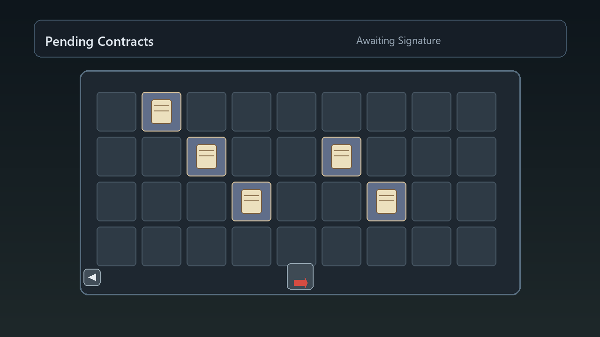

# ContractScrolls

Vanilla-feeling, lightweight Paper plugin that lets players write, propose, and sign contracts. The plugin **does not enforce** the contract; it creates tamper-evident records and a server-side audit trail.
Its goal is to reduce player conflicts and give staff clearer evidence, so staff spend less time handling stealing/theft disputes.

**Version:** 1.0.0

> **Limited Use License (Plugin Use Only)**
> You may run the compiled plugin on Minecraft servers and redistribute the unmodified jar.
> No rights are granted to use or modify the source code or distribute modified binaries.

## Requirements
- Paper 1.21.x
- Java 21

## What It Does
- `/contract propose <player>` uses the signed book in hand as the contract terms and notifies the target.
- Proposing automatically records the proposer signature.
- `/contract sign <contractId>` records signatures.
- `/contract view` and `/contract list` open a contracts UI with filters.
- Clicking a contract in UI opens the contract book for reading.
- Staff can open any player's contracts UI with `/contract admin search <player>`.
- Contracts UI filter cycles between `All`, `Accepted`, and `Denied`.
- `/contract revoke <contractId>` cancels a proposal before the other party signs.

The plugin stores a full contract record on disk.

## Screenshots

## What It Does Not Do
- It does not enforce contract terms.
- It does not auto-punish or auto-reward players.
- It does not integrate with economy or other plugins.

## Trust Model
- Contract terms are hashed with SHA-256 at proposal time.
- The hash is stored in server-side storage and a short prefix is shown in contract views.
- When viewing a contract, staff will see a red warning if the hash does not match.

Hash input (concatenated with `|` separators):
- `proposerUUID + counterpartyUUID + createdAt + nonce + pages`

## Usage Flow
1. Player writes terms in a signed book.
2. Player runs `/contract propose <player>` while holding the signed book.
3. Target reviews the contract from chat/UI and uses `/contract sign <contractId>`.
4. When both sign, the contract becomes immutable.

Note: `/contract propose <player>` uses cached-only player lookups to avoid blocking the server thread. The target must be online or have joined before.

## Commands
- `/contract`
- `/contract propose <player>`
- `/contract sign <contractId>`
- `/contract view`
- `/contract view <contractId>`
- `/contract pending` or `/contract inbox`
- `/contract list [player]`
- `/contract revoke <contractId>`
- `/contract admin search <player>`

## Permissions
- `contractscrolls.use` (default: true)
- `contractscrolls.staff` (default: op)

## Configuration
`plugins/ContractScrolls/config.yml`

- `maxContractsPerPlayer`: Total stored contracts a player can be involved in.
- `maxPendingProposals`: Maximum proposals awaiting the other party’s signature.
- `proposalCooldownSeconds`: Cooldown between proposals.
- `contractExpiryHours`: 0 disables expiration. Positive values expire unsigned contracts after N hours.
- `expirationSweepSeconds`: How often expired pending contracts are persisted as `EXPIRED`.
- `allowThirdPartyWitness`: Reserved for future witness support.
- `receiptBookEnabled`: Legacy compatibility flag (receipt books are currently disabled).
- `storage.mode`: `SQLITE` (default) or `MYSQL`.
- `storage.mysql.*`: MySQL host/port/database/user/password/SSL/table settings.
- `storage.sqlite.file`: SQLite database file path (relative to `plugins/ContractScrolls/` unless absolute).
- In `MYSQL` mode, if MySQL cannot initialize, the plugin automatically falls back to `SQLITE`.
- `timezoneDisplay`: `SERVER` or a ZoneId like `UTC` or `America/New_York`.
- `stripColorCodes`: Remove legacy `§` formatting codes from terms.

## Storage Format
Storage backends:
- `MYSQL`: single table (default table name: `contracts`)
- `SQLITE`: single local `.db` file (default `plugins/ContractScrolls/contracts.db`)

Fields include:
- `contractId`
- `proposer.uuid` + `proposer.name`
- `counterparty.uuid` + `counterparty.name`
- `createdAt`, `signed.*`, `expiresAt`
- `server.name`, `server.pluginVersion`
- `terms.pages`, `terms.hash`, `terms.nonce`
- `status`
- `signLocation.*`
- `dataVersion`

## Admin Search
`/contract admin search <player>` opens that player's contracts UI.
UI filters:
- `All`
- `Accepted`
- `Denied`

## Build Outputs
- Standalone jar (default): `build/libs/ContractScrolls-<version>.jar`
- Thin jar: `build/libs/ContractScrolls-<version>-thin.jar`

The standalone jar includes Cloud and Kotlin runtime classes and relocates Cloud to avoid conflicts.
The thin jar relies on Paper `libraries` to download dependencies at runtime.

## License & Copyright
Copyright (c) 2026 Lou Morel (Canada). All rights reserved.

This repository is proprietary. Permission is granted to use the compiled
ContractScrolls plugin solely by installing and running it on Minecraft servers.
You may redistribute the unmodified plugin binary (the official jar), provided
the LICENSE and NOTICE remain included and the jar is unmodified.

No other rights are granted. You may not use the source code, and you may not
distribute modified versions of the plugin.

See `LICENSE` for the full terms.

